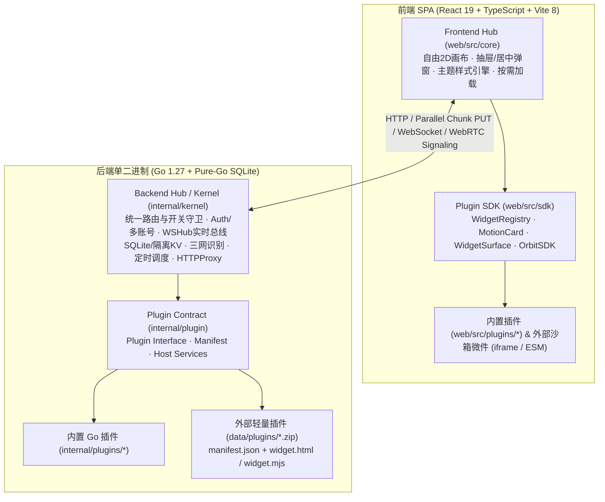

<div align="center">
  
  <h1>Orbit · 星轨</h1>
  <p><strong>美观 · 轻量 · 快速 · 开箱即用的个人快速起始页</strong></p>
  <p>基于 <strong>Hub + Plugin</strong> 微内核插件架构，开箱即享智能导航、统一搜索、实时天气、节点监控、跨端剪贴板与局域网千兆快传</p>

  <p>
    <a href="https://github.com/MIKU-N/Orbit/releases/latest">
      
    </a>
    <a href="https://github.com/MIKU-N/Orbit/actions/workflows/docker.yml">
      
    </a>
    <a href="https://github.com/MIKU-N/Orbit/pkgs/container/orbit">
      
    </a>
    
    
    <a href="./LICENSE">
      
    </a>
  </p>
</div>

---

## 为什么选择 Orbit？

- **美观**：毛玻璃卡片与极简无卡片双风格自由切换，支持背景模糊/透明度/圆角/全局字体精细定制、日夜丝滑可打断切换动画、多模壁纸轮换，以及桌面端自由 2D 拖拽缩放与移动端悬浮胶囊适配。
- **轻量**：纯 Go 单一静态可执行文件内嵌 React SPA 与纯 Go SQLite（`modernc.org/sqlite`），**无外部数据库、无 CGO 依赖**，日常运行内存仅 **10–25 MB**；未启用或隐藏的组件严格按需加载，不浪费任何带宽与请求。
- **快速**：全部前端资源默认**本地自托管加载**（零外部 CDN 强依赖，亦支持配置可信 CDN 镜像）；书签根据来源网络自动切换 `LAN / Tailscale / WAN` 地址；内置 4 路并行分片直写与 4 通道 WebRTC P2P 快传，轻松跑满千兆以上内网带宽。
- **开箱即用**：一条 `docker compose up -d` 即可启动，首次打开网页引导创建管理员，预置 8 款常用插件、渐变壁纸与常用字体，无需额外配置数据库或复杂参数。
- **易于扩展**：采用清晰的 **Hub + Plugin** 架构，核心底座与业务插件彻底解耦，无论是开发原生 Go + React 插件还是上传 `.zip` 轻量外部插件都非常顺手。

---

## 快速开始（推荐 Docker Compose）

GitHub Actions 会自动构建并发布多架构镜像（支持 **`linux/amd64`** 与 **`linux/arm64`**）：`ghcr.io/miku-n/orbit:latest`。

### 1. 一键部署（推荐：内网服务器 / NAS / 软路由）

使用仓库提供的生产编排文件 [`docker-compose.prod.yml`](./docker-compose.prod.yml)（内置健康检查、日志轮转与 `host` 网络优化）：

```bash
mkdir -p /opt/orbit/data && cd /opt/orbit

# 下载 Docker Compose 编排文件
curl -fsSLO https://raw.githubusercontent.com/MIKU-N/Orbit/main/docker-compose.prod.yml

# 启动服务
docker compose -f docker-compose.prod.yml up -d
```

启动后访问 `http://<服务器IP>:8080`，按首次引导创建管理员账号即可使用。

> **为什么生产编排推荐 `network_mode: host` + `pid: host`？**
> - 直接获取客户端真实来源 IP，避免 Docker NAT 改写为 `172.x.0.1` 导致 `LAN / Tailscale / WAN` 三网路由误判。
> - 让「节点监控」准确读取宿主机真实网卡吞吐、进程数与系统发行版（`/etc/os-release`）。
> - 让外部插件 `httpProxy` 可直连宿主机与局域网/Tailscale 内其他服务。

### 2. 轻量桥接模式（适合 macOS / Windows / 端口映射场景）

若无需 `host` 网络，可直接创建 `docker-compose.yml`：

```yaml
services:
  orbit:
    image: ghcr.io/miku-n/orbit:latest
    container_name: orbit
    restart: unless-stopped
    ports:
      - "8080:8080"
    volumes:
      - ./data:/app/data
    environment:
      - TZ=Asia/Shanghai
      - ORBIT_ADDR=:8080
      - ORBIT_DATA_DIR=/app/data
      - ORBIT_LAN_MAX_MB=0        # 局域网单文件不限制
      - ORBIT_TS_MAX_MB=2048      # Tailscale 单文件上限 (MB)
      - ORBIT_WAN_MAX_MB=100      # 公网单文件上限 (MB)
      - ORBIT_MAX_STORAGE_MB=20480
```

```bash
docker compose up -d
```

### 3. 自定义配置与升级维护

在 `docker-compose.prod.yml` 同目录新建 `.env` 即可按需覆盖默认参数，无需改动编排文件：

```dotenv
# host 模式下通过 ORBIT_ADDR 修改监听端口
ORBIT_ADDR=:18080
# 数据目录
ORBIT_DATA_PATH=/opt/orbit/data
# 纯内网直连建议 false；若前端挂有 Nginx / Caddy 反代请设为 true
ORBIT_TRUST_PROXY=false
# 公网反代访问域名（逗号分隔），匹配时强制按 WAN 限额策略执行
ORBIT_WAN_HOSTS=orbit.example.com
# 单文件与暂存总容量上限（单位 MB，0 表示不限制）
ORBIT_LAN_MAX_MB=0
ORBIT_TS_MAX_MB=2048
ORBIT_WAN_MAX_MB=100
ORBIT_MAX_STORAGE_MB=20480
```

> 如需在「节点监控」中查看宿主机额外数据盘/NAS 存储卷，可在 `volumes` 中追加只读挂载，例如 `- /mnt/storage:/mnt/storage:ro`。

```bash
# 平滑升级到最新版本（数据库自动迁移，数据无损）
docker compose -f docker-compose.prod.yml pull
docker compose -f docker-compose.prod.yml up -d

# 完整备份（SQLite 使用 WAL 模式，建议停机打包整个 data 目录）
docker compose -f docker-compose.prod.yml stop
tar -czf orbit-backup-$(date +%Y%m%d).tar.gz data/
docker compose -f docker-compose.prod.yml start
```

<details>
<summary>其他部署方式（GitHub Releases 静态二进制 / docker run / 源码构建）</summary>

#### A. 直接下载预编译单文件（无 Docker 依赖）

前往 [GitHub Releases](https://github.com/MIKU-N/Orbit/releases/latest) 下载对应平台二进制（支持 `linux/amd64`、`linux/arm64`、`darwin/amd64`、`darwin/arm64`）：

```bash
chmod +x orbit-v0.2.0-linux-amd64
./orbit-v0.2.0-linux-amd64
```

#### B. `docker run` 单命令启动

```bash
docker run -d \
  --name orbit \
  --restart unless-stopped \
  --network host \
  --pid host \
  -v /opt/orbit/data:/app/data \
  -v /etc/os-release:/etc/os-release:ro \
  -e TZ=Asia/Shanghai \
  -e ORBIT_ADDR=:8080 \
  -e ORBIT_TRUST_PROXY=false \
  ghcr.io/miku-n/orbit:latest
```

#### C. 本地源码编译

环境要求：**Go 1.27+**、**Node.js 24+**。

```bash
git clone https://github.com/MIKU-N/Orbit.git
cd Orbit
make build
./bin/orbit
```

也可直接用 [`docker-compose.yml`](./docker-compose.yml) 从源码构建镜像：`docker compose up -d --build`。

</details>

---

## 核心功能与内置插件

所有功能均以插件形式挂载在 Orbit Hub 上，可在「插件中心」按需启用、禁用或配置访客可见性（禁用后界面入口与对应后端 API 同步关闭）：

| 插件 ID | 名称 | 层级 | 核心能力 | 访客默认 |
| :--- | :--- | :--- | :--- | :--- |
| `orbit.clock` | 数字时钟 | Official | 极简居中时钟，支持秒数显示与日期自定义 | 完整可用 |
| `orbit.search` | 统一搜索 | Core | 多引擎快捷切换、前缀触发、站内书签/剪贴板/文件实时聚合检索 | 只读可用 |
| `orbit.weather` | 实时天气 | Official | 彩云天气 / 中国天气（CMA）双数据源，支持一键定位与多指标自定义 | 只读展示 |
| `orbit.hitokoto` | 每日一言 | Official | 在线一言与内置/自定义语录轮播，支持对齐与切换间隔设置 | 只读展示 |
| `orbit.bookmarks` | 极简导航 | Core | `LAN / Tailscale / WAN` 三网智能路由书签、拖拽排序、浏览器 HTML & Sun-Panel 导入 | 隐藏 |
| `orbit.monitor` | 节点监控 | Official | 宿主机 CPU、内存、Swap、多挂载点磁盘、温度与实时网络吞吐遥测 | 隐藏 |
| `orbit.clipboard` | 跨端剪贴板 | Core | WebSocket 毫秒级多端同步、支持 `Ctrl+V` 截图粘贴、置顶、取件码分享与 API Token 推送 | 登录提示 |
| `orbit.transfer` | 极速快传 | Core | 局域网 4 通道 WebRTC P2P 直传、4 路并行分片直写暂存箱与 6 位阅后即焚取件码（`/s/XXXXXX`） | 登录提示 |

此外，底座还内置：
- **多账号与细粒度共享**：管理员可创建子账号，默认严格数据隔离，并按需勾选共享「外观 / 书签 / 剪贴板 / 文件 / 监控」。
- **统一设置与文件管理**：所有设置居中弹窗呈现；提供本地资源与插件文件管理面板。
- **全局视觉与隐私控制**：支持暗色/浅色主题、全局动画总开关、本地字体上传、本地/Bing 壁纸管理，以及本地优先静态资源策略（内置屏蔽已污染的 BootCDN / Staticfile 域名）。

---

## Hub + Plugin 架构与开发指南

Orbit 采用 **Hub（微内核底座）+ Plugin（可插拔扩展）** 的分层设计：Hub 统一托管认证、存储、网络感知、实时通信与画布渲染，插件只需专注自身业务逻辑，开发成本极低。



### 目录结构一览

```text
Orbit/
├── cmd/orbit/              # 启动入口（装配 Hub 与内置插件、TCP 缓冲区调优）
├── internal/
│   ├── kernel/             # Backend Hub：路由、认证、WSHub、KV 存储、外部插件加载器与 httpProxy
│   ├── plugin/             # Hub ↔ Plugin 协议定义（Manifest、Host、RouteGroup、WSHub 等接口）
│   ├── plugins/            # 8 个官方内置后端插件（彼此独立解耦）
│   ├── config/             # 环境变量与版本配置
│   ├── db/                 # 纯 Go SQLite 初始化与自动迁移
│   └── webui/              # embed.FS 内嵌前端静态产物
└── web/src/
    ├── core/               # Frontend Hub：顶栏、自由布局引擎、抽屉、居中弹窗、插件中心、通知栈
    ├── sdk/                # 前端插件开发 SDK（类型、注册表、样式原语、通用组件）
    └── plugins/            # 内置前端插件实现
```

### 开发方式 1：轻量外部插件（无需编译，`.zip` 热安装）

适合快速接入内网服务卡片（如 NAS、下载器、智能家居、监控面板等）。只需准备 `manifest.json` + `widget.html`（或 `widget.mjs`）打包为 `.zip`，在网页「设置 → 插件中心」上传即可实时生效：

```json
{
  "id": "demo.hello",
  "name": "示例微件",
  "version": "1.0.0",
  "description": "展示 Hub 提供的样式托管、隔离 KV 与内网代理能力",
  "icon": "sparkles",
  "style": { "managed": true, "supportsCardless": true },
  "contributes": {
    "widgets": [
      { "id": "main", "label": "示例", "minW": 240, "defaultW": 320, "resizable": true, "defaultVisible": true }
    ]
  },
  "external": {
    "entry": "widget.html",
    "renderMode": "iframe",
    "httpProxy": {
      "status": { "method": "GET", "url": "http://192.168.1.10:8080/api/status", "timeoutMs": 5000 }
    }
  }
}
```

- **直通内网 `httpProxy`**：由 Hub 服务端直接代理请求内网 / Tailscale 接口，免去浏览器跨域与暴露密钥烦恼，并自动对非管理员脱敏 `secret` 配置字段。
- **样式托管**：`managed: true` 时自动注入当前主题的毛玻璃、圆角、字体与配色 CSS Token，与 Orbit 原生视觉浑然一体。

### 开发方式 2：原生内置插件（Go + React）

后端仅需实现 [`internal/plugin/host.go`](./internal/plugin/host.go) 中的 3 个极简方法，并在 [`cmd/orbit/main.go`](./cmd/orbit/main.go) 注册即可获得完整的认证、隔离 KV、`WSHub` 推送、定时任务和路由级启停守卫：

```go
type Plugin interface {
    Manifest() Manifest
    Init(host Host) error
    RegisterRoutes(r RouteGroup)
}
```

前端在 `web/src/plugins/<name>/` 中通过 `web/src/sdk` 声明对应的 `render` 微件、`drawer` 抽屉或 `settingsPanel` 设置面板即可自动接入画布、搜索与设置中心。

---

## 环境变量说明

| 变量名 | 默认值 | 说明 |
| :--- | :--- | :--- |
| `ORBIT_ADDR` | `:8080` | 监听地址与端口（也兼容 `ORBIT_PORT`） |
| `ORBIT_DATA_DIR` | `./data`（容器内 `/app/data`） | SQLite 数据库、`.jwt_secret`、外部插件与上传文件存储目录 |
| `ORBIT_JWT_SECRET` | 自动生成 | 可选：自定义 JWT 签名密钥（留空时自动生成并持久化到 `ORBIT_DATA_DIR/.jwt_secret`） |
| `ORBIT_LAN_MAX_MB` | `0`（不限） | 局域网单文件上限 (MB)，`0` 表示不限制 |
| `ORBIT_TS_MAX_MB` | `2048` | Tailscale 单文件上限 (MB)，`0` 表示不限制 |
| `ORBIT_WAN_MAX_MB` | `100` | 公网单文件上限 (MB)，`0` 表示不限制 |
| `ORBIT_MAX_STORAGE_MB` | `20480` | 暂存区总容量上限 (MB)，`0` 表示不限制 |
| `ORBIT_TRUST_PROXY` | `true`（`prod` 编排默认 `false`） | 是否信任内网/Tailscale 反代传入的 `X-Forwarded-For` / `X-Real-IP` |
| `ORBIT_WAN_HOSTS` | 空 | 逗号分隔的公网域名列表，匹配时强制按外网 (`wan`) 策略限额 |
| `ORBIT_ADMIN_USER` / `ORBIT_ADMIN_PASS` | 空 | 可选：仅在数据库尚无任何用户时自动初始化首个管理员账号 |
| `TZ` | `Asia/Shanghai` | 容器时区 |

---

## 内网 HTTPS、公网反代与终端推送

- **局域网 HTTPS 与一键复制**：登录 Cookie 与 WebSocket 均已自动适配 HTTP/HTTPS；但浏览器仅在安全上下文（`https://` 或 `localhost`）中开放 `navigator.clipboard` 写入。若高频使用剪贴板一键复制，推荐为内网域名配置 HTTPS（或按需开启浏览器安全源白名单）。
- **Tailscale + 公网 VPS 反代**：推荐将 Orbit 部署在家里服务器 / NAS，公网 VPS 通过 Tailscale 内网 IP 反代（参考 [`deploy/Caddyfile.example`](./deploy/Caddyfile.example) 与 [`deploy/nginx.conf.example`](./deploy/nginx.conf.example)）。反代时需转发 `X-Forwarded-For`、`X-Forwarded-Proto` 与 WebSocket `Upgrade/Connection`，并在 Orbit 侧开启 `ORBIT_TRUST_PROXY=true` 与 `ORBIT_WAN_HOSTS`。
- **终端 / 快捷指令一键推剪贴板**（在右上角「账号管理」中复制个人 `API Token`）：

```bash
curl -X POST https://orbit.example.com/api/clips \
  -H "Authorization: Bearer orb_你的Token" \
  -H "Content-Type: application/json" \
  -d '{"content":"来自终端的一段文本"}'
```

---

## 开源协议 / License

本项目采用 **[Apache License 2.0](./LICENSE)** 开源。
